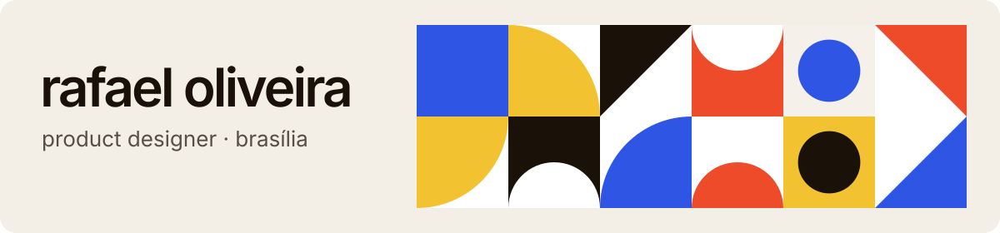

Product designer em Brasília. Desenho produtos digitais para fintech, com atenção a design systems e acessibilidade, e escrevo o código quando o protótipo precisa ser de verdade.

Hoje sou **Product Design Intern no BRB — Banco de Brasília** e estudo **Engenharia de Software** na Uniceplac.
Busco uma vaga de **Product Designer em fintech**, em Brasília ou remota.

**[Portfólio](https://rafaelsanoli.com.br)** · **[LinkedIn](https://www.linkedin.com/in/rafaelsanoli)**

 

### Cases

**Novo app Nação BRB FLA** · `trabalho no BRB` 
O novo app do banco digital do Flamengo e do Banco BRB: benchmark de 13 bancos, análise de reclamações e um design system completo, evoluindo o app sem afastar quem já usa.

**Pix Automático** · `fintech · mobile` 
O total do mês logo na entrada e um cancelamento sem pegadinha, com "cancelar só esta cobrança" separado de "cancelar a autorização". Acerto nas tarefas de 73% para 100% entre as rodadas de teste.

**Design system da fio** · `design system` 
Tokens em três camadas e 22 componentes, com foco no que kits genéricos não resolvem: valor em reais, saldo oculto, linha de transação e código por SMS.

**Painel MEI** · `fintech b2b · web` 
Um painel para microempreendedores saberem em 10 segundos se vão estourar o limite do MEI, com uma projeção que se apresenta como estimativa.

**Abertura de conta acessível** · `acessibilidade · mobile` 
Documento e selfie, dados, código e senha redesenhados para quem usa leitor de tela, com a spec de acessibilidade ao lado de cada tela.

> Os testes dos projetos autorais foram feitos com proto-personas de IA e servem para comparar versões. O próximo passo é repetir com pessoas reais.

 

### Como eu trabalho

- **protótipo em código junto com o figma.** O time sente o fluxo de verdade antes de qualquer ticket.
- **evoluir antes de reinventar.** Quem já usa o produto não deveria precisar reaprender.
- **tokens antes de telas.** Decisão de cor e espaço vira código uma vez só.
- **acessibilidade vai na spec, não no fim.** Ordem de foco, fala do leitor e tamanho do alvo ao lado de cada tela.

 

### Trajetória

- `2026 →` **Product Design Intern** · BRB — Banco de Brasília
- `2025` **DBA Intern** · Topocart
- `até 2028` **Engenharia de Software** · Uniceplac

 

### Ferramentas

**Design** — Figma, prototipagem, pesquisa, design systems, acessibilidade, motion 
**Código** — React, TypeScript, JavaScript, Angular

 

---

**EN** · Product designer in Brasília, Brazil. I design digital products for fintech, with a focus on design systems and accessibility. Product Design Intern at BRB, Software Engineering student, looking for a Product Designer role in fintech (Brasília or remote).
